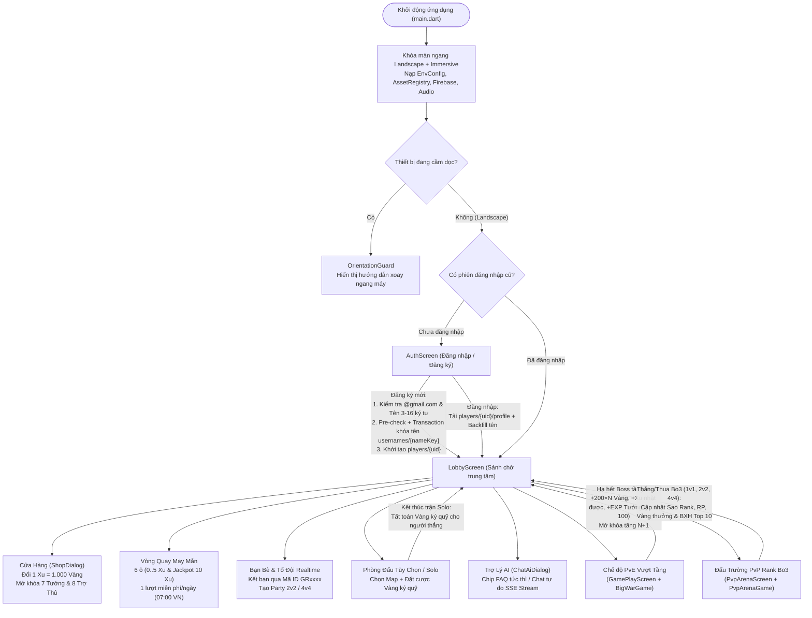
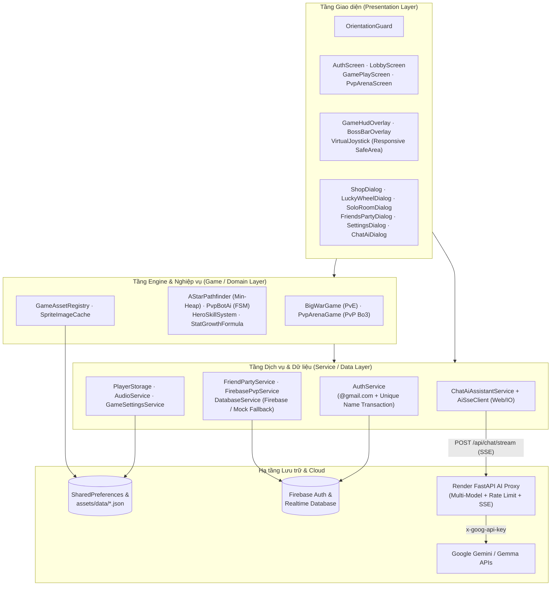

# 🏆 Big-War — 2D Action RPG Cross-Platform (Mobile & Web)

> **Học phần:** `INT1449 · Lập trình di động`  
> **Nền tảng hỗ trợ:** **Android (APK)  · Web (`https://my-game-ec4fa.web.app`)**  
> **Công nghệ cốt lõi:** **Flutter + Flame Engine (`1.38.2`) · Firebase Auth & Realtime Database · FastAPI Multi-Model Gemini SSE Proxy (Render)**

-02569B?logo=flutter)


---

## 📑 Mục lục

1. [Tổng quan dự án & Triết lý thiết kế](#1-tổng-quan-dự-án--triết-lý-thiết-kế)
2. [Luồng nghiệp vụ tổng thể của hệ thống](#2-luồng-nghiệp-vụ-tổng-thể-của-hệ-thống)
3. [Chi tiết các phân hệ tính năng](#3-chi-tiết-các-phân-hệ-tính-năng)
4. [Kiến trúc phần mềm & Cấu trúc thư mục](#4-kiến-trúc-phần-mềm--cấu-trúc-thư-mục)
5. [Bảo mật xác thực, Chống trùng lặp & Quyền riêng tư](#5-bảo-mật-xác-thực-chống-trùng-lặp--quyền-riêng-tư)
6. [Yêu cầu môi trường & Cài đặt nhanh](#6-yêu-cầu-môi-trường--cài-đặt-nhanh)
7. [Cấu hình biến môi trường & Triển khai AI Proxy trên Render](#7-cấu-hình-biến-môi-trường--triển-khai-ai-proxy-trên-render)
8. [Hướng dẫn chạy ứng dụng, Build APK & CI/CD](#8-hướng-dẫn-chạy-ứng-dụng-build-apk--cicd)
9. [Vị trí lưu trữ dữ liệu & Mở rộng Data-Driven](#9-vị-trí-lưu-trữ-dữ-liệu--mở-rộng-data-driven)
10. [Ứng dụng AI trong phát triển & Kịch bản Demo / Vấn đáp](#10-ứng-dụng-ai-trong-phát-triển--kịch-bản-demo--vấn-đáp)

---

## 1. Tổng quan dự án & Triết lý thiết kế

**Big-War** là tựa game hành động nhập vai góc nhìn từ trên xuống (**2D Top-Down Action RPG**) màn hình ngang (`Landscape`), được xây dựng bằng **Flutter** và **Flame Engine**.

Dự án được thiết kế theo kiến trúc **Offline-First kết hợp Online Realtime**:
- **Offline-First không gián đoạn:** Lưu trữ tức thì xuống `SharedPreferences`; toàn bộ chế độ vượt tầng PvE, Cửa hàng mở khóa tướng/trợ thủ, Vòng quay may mắn, Đấu trường PvP với Bot AI 3 bậc độ khó và Trợ lý AI chế độ Demo đều hoạt động mượt mà ngay cả khi mất mạng.
- **Online Realtime đa thiết bị:** Xác thực tài khoản `@gmail.com` qua **Firebase Auth**, khóa tên nhân vật duy nhất toàn máy chủ, đồng bộ đám mây hồ sơ người chơi, Bảng xếp hạng Top Server (với danh hiệu **Thách Đấu Top 10**), Kết bạn & trạng thái Online thời gian thực, Tổ đội 2v2/4v4, Phòng đấu tùy chọn / Solo đặt cược Vàng và **Trợ lý AI phản hồi theo luồng SSE thời gian thực (kiểu ChatGPT)** qua máy chủ **FastAPI Proxy** trên Render.

### Điểm nhấn kỹ thuật
- **Tối ưu hiển thị đa thiết bị (iOS & Android):** Lớp bảo vệ hướng xoay `OrientationGuard` tự nhắc xoay ngang khi cầm dọc; giao diện HUD trong trận dùng `SafeArea` + `LayoutBuilder` tự động co giãn Joystick, cụm nút kỹ năng và hạ thanh máu Boss xuống dưới Top Bar trên màn hình điện thoại (`< 840dp`) để không bao giờ che khuất nút bấm trên các dòng máy có tai thỏ, Dynamic Island hoặc màn hình dài `20:9`.
- **Thuật toán AI trong game:** Quái vật & Bot sử dụng thuật toán tìm đường **A\*** với hàng đợi ưu tiên **Binary Min-Heap** tự cài đặt, kết hợp **Line-of-Sight raycast** và **chống cắt góc chéo** qua vật cản; PvP Bot AI vận hành theo máy trạng thái hữu hạn (**FSM 3 cấp độ**).
- **Trợ lý AI Streaming & Multi-Model Failover:** Máy chủ proxy giữ kín `GEMINI_API_KEY`, tự động xoay vòng **11 mô hình Gemini / Gemma** khi hết hạn mức (`429`) và truyền văn bản từng mảnh qua chuẩn **Server-Sent Events (SSE)** về cả Web (`fetch` `ReadableStream`) lẫn Mobile (`StreamedResponse`).

---

## 2. Luồng nghiệp vụ tổng thể của hệ thống



---

## 3. Chi tiết các phân hệ tính năng

### ⚔️ 3.1. Chế độ PvE Vượt Tầng Hầm Ngục & AI Tìm Đường A\*
- **5 bản đồ chiến trường đa chủ đề** ([assets/data/maps.json](assets/data/maps.json)): *Đấu Trường Băng Giá*, *Đảo Băng Tuyết*, *Rừng Cây Cổ Thụ*, *Điện Thờ Cổ Long*, *Hỏa Ngục Dung Nham* (lưới `36×24` ô, `32px/ô`), bố trí trụ đá chắn đạn, cổng quái và điểm ăn Buff.
- **Độ khó leo tầng tăng tiến (Progressive Floor Scaling):** Càng lên tầng cao, số lượng Boss & quái tinh anh, lượng máu, sát thương, tốc độ di chuyển và mật độ cầu lửa của Boss càng tăng. Tiến độ tầng cao nhất (`pveHighestFloor`) được lưu tự động sau mỗi màn thắng.
- **Hệ thống AI Quái vật & Boss 2 giai đoạn:**
  - **Xác Sống Hầm Ngục (Zombie):** Cận chiến bám đuổi bằng thuật toán **A\*** ([lib/game/ai/astar_pathfinder.dart](lib/game/ai/astar_pathfinder.dart)), giãn chu kỳ tính đường (`0.45s` + độ lệch ngẫu nhiên) để giữ vững `60 FPS`.
  - **Cung Thủ Xương Khô (Skeleton):** **Kiting AI** giữ khoảng cách bắn tỉa `110–240px`, tự lùi khi bị áp sát và tự vòng qua cột đá tìm góc bắn.
  - **Chúa Tể Hầm Ngục Hoàng Kim (Boss):** Gọi viện binh ở các ngưỡng `70% / 50% / 30% HP`; khi máu dưới `50%` chuyển sang trạng thái **Cuồng Nộ** tăng tốc, dậm đất AoE có vùng cảnh báo đỏ và bắn cầu lửa tỏa tròn. Khi tiêu diệt toàn bộ Boss của tầng, quái phụ còn sót tự động bị quét sạch để qua màn.
  - **Bảo toàn phần thưởng:** Mọi đồng Xu nhặt được trong trận đều được cộng vào tài khoản kể cả khi thắng màn, thất thủ hay thoát ra Sảnh chờ; vượt tầng `N` nhận thêm `200 × N` Vàng.

### 🏟️ 3.2. Đấu Trường PvP Rank Bo3, Tổ Đội & Phòng Solo Cược Vàng
- **3 chế độ Đấu Rank thể thức Best-of-3 (`90 giây/hiệp`):**
  - **1v1 Đấu Đơn:** Thưởng thắng `+200 Vàng`.
  - **2v2 Song Đấu:** Hiệp đồng tổ đội 2 người, thưởng thắng `+350 Vàng`.
  - **4v4 Quân Đoàn:** Đại chiến 4 đấu 4, thưởng thắng `+500 Vàng`.
  - Bản đồ đấu trường đối xứng `960×640px` (`30×20` ô) được đồng bộ xác định giữa các máy qua hàm băm **FNV-1a** theo `roomId`. Nếu tìm trận quá `20 giây` chưa đủ người thật, hệ thống tự động bù **PvP Bot AI** tương ứng bậc Rank.
- **Hệ thống 7 Bậc Rank tính theo Sao & RP** ([lib/models/pvp_match.dart](lib/models/pvp_match.dart)):
  - *Đồng → Bạc → Vàng → Bạch Kim → Kim Cương*: mỗi bậc gồm **3 Sao** (thắng `+1 sao`, thua `-1 sao`, bảo vệ không tụt dưới `0 sao Đồng`).
  - *Huyền Thoại*: đạt từ mốc **15 Sao tích lũy** (`>= 2.000 RP`).
  - *Thách Đấu*: danh hiệu cao quý dành riêng cho **Top 10 người chơi nhiều sao nhất Server** thuộc bậc Huyền Thoại, hiển thị huy hiệu và thứ hạng `#1..#10` trực tiếp trên BXH & Hồ sơ.
- **Bạn Bè, Tổ Đội Realtime & Phòng Solo Cược Vàng:**
  - Kết bạn qua **Mã ID (`GRxxxx`)** hoặc tìm theo tên nhân vật; thanh bên bạn bè (`LobbyFriendsSidebar`) cập nhật trạng thái *Đang Online / Ngoại tuyến* thời gian thực nhờ `onDisconnect()` của Firebase.
  - Mời bạn vào **Tổ Đội (Party)** với thông báo nổi tự động đóng sau `5 giây`, đồng bộ trạng thái *Sẵn sàng* và đưa cả đội vào chung phòng trận đấu.
  - **Phòng Đấu Tùy Chọn / Solo ([lib/screens/solo_room_dialog.dart](lib/screens/solo_room_dialog.dart)):** Tạo phòng hoặc nhập mã phòng để thách đấu bạn bè, tùy chọn bản đồ yêu thích và đặt **mức cược Vàng ký quỹ (Escrow)** minh bạch — người chiến thắng nhận toàn bộ giải thưởng.

### 🧙‍♂️ 3.3. Hệ Thống Nhân Vật (Level 1 → 100) & Trợ Thủ AI Bay
- **7 Nhân vật mở bán tại Cửa Hàng** *(kèm 2 nhân vật mở rộng Valeria & Garrick trong Registry)* — mỗi tướng có đòn đánh thường và **bộ 3 kỹ năng riêng** tiêu hao năng lượng Ki:
  1. **George — Chiến Binh Búa** *(Mặc định — 0 Vàng)*: Đấu sĩ cận chiến máu trâu (*Búa Cuồng Phong*, *Nện Đất Chấn Động*, *Cơn Cuồng Nộ*).
  2. **Xạ Thủ Ranger / Lyra** *(4.000 Vàng)*: Tầm xa cơ động (*Tiễn Vũ Liên Châu*, *Nhào Lộn Bẫy Gai*, *Mưa Sao Băng*).
  3. **Hiệp Sĩ Tanker / Braum** *(4.000 Vàng)*: Đỡ đòn phản chấn (*Húc Khiên Xung Kích*, *Pháo Đài Sắt -65% DMG & hồi máu*, *Địa Chấn Phán Quyết*).
  4. **Ninja Sát Thủ / Hayate** *(4.500 Vàng)*: Ám sát bạo kích (*Phi Tiêu Lướt Ảnh*, *Khói Ẩn Thân*, *Ảnh Sát Liên Hoàn*).
  5. **Nova Blade (NOVA-07)** *(6.000 Vàng)*: Đấu sĩ ánh sáng (*Energy Slash*, *Shadow Dash*, *Quantum Burst hút địch nổ AoE*).
  6. **Shadow (SHADOW-01)** *(6.000 Vàng)*: Sát thủ hư không (*Plasma Shot*, *Cyber Spin*, *Phantom Dash*).
  7. **Ember (EMBER-02)** *(6.500 Vàng)*: Pháp sư hỏa lực diện rộng (*Hỏa Cầu Liên Hoàn*, *Cột Lửa Địa Ngục*, *Thái Dương Bộc Phá*).
- **Hai tầng cấp độ phát triển:**
  - **Cấp Thông Thạo Vĩnh Viễn (`Level 1 → 100`):** Tướng ra trận nhận EXP sau mỗi trận PvE/PvP (kể cả thắng hay thua), cộng vĩnh viễn `HP`, `Ki` và `ATK` theo công thức riêng của từng hệ tướng ([lib/core/stat_growth_formula.dart](lib/core/stat_growth_formula.dart)).
  - **Cấp Trong Trận PvE (`Level 1 → 15`):** Nhặt Ngọc EXP rơi từ quái để cường hóa sức mạnh ngay trong màn chơi.
- **8 Trợ Thủ AI Bay (Companions)** tự động bay theo bắn hỗ trợ, hút vật phẩm và kích hoạt tuyệt kỹ chủ động bằng nút **`PET` / phím `E`**:
  - *Bậc 1:* **Trợ Thủ Công Kích** (`2.000 Vàng`), **Trợ Thủ Phòng Ngự** (`2.500 Vàng`), **Trợ Thủ Khống Chế** (`3.000 Vàng`).
  - *Bậc 2:* **Cyber Drone PIXEL-01** (`4.000 Vàng`), **Hồ Ly Luna** (`4.500 Vàng`), **ORBIT-03 Drone** (`5.000 Vàng`).
  - *Bậc 3 Huyền Thoại:* **Aegis-X9 Lôi Từ** (`8.000 Vàng` — gom quái, hút vật phẩm toàn bản đồ & tạo khiên), **Pyro-Frost Dragon** (`10.000 Vàng` — Hơi Thở Bão Tố đóng băng & tăng `30% ATK`).

### 🪙 3.4. Kinh Tế, Vòng Quay May Mắn & Âm Thanh
- **Tiền tệ tinh gọn (Xu & Vàng):** Tỷ giá cố định **1 Xu = 1.000 Vàng**, đổi trực tiếp tại Cửa hàng hoặc trên thanh tiền tệ ở Sảnh chờ.
- **Vòng Quay May Mắn 6 ô** ([lib/screens/lucky_wheel_dialog.dart](lib/screens/lucky_wheel_dialog.dart)): Gồm các mốc `0 Xu`, `1 Xu`, `2 Xu`, `3 Xu`, `5 Xu` và giải **Jackpot `10 Xu` (`= 10.000 Vàng`)**. Tặng **1 lượt quay miễn phí mỗi ngày**, làm mới tự động lúc **00:00 UTC (07:00 sáng giờ Việt Nam)**.
- **Âm thanh đa kênh chống xung đột** ([lib/services/audio_service.dart](lib/services/audio_service.dart)): **4 bản nhạc nền BGM** (*Lobby*, *Dungeon*, *Boss*, *PvP*) và **11 hiệu ứng âm thanh SFX**, có hàng đợi tuần tự hóa thao tác bật/tắt tránh lỗi race-condition và lưu cấu hình vào `SharedPreferences`.

### 🤖 3.5. Trợ Lý Chat AI Streaming (SSE kiểu ChatGPT + Multi-Model Failover)
- **Kiến trúc Proxy bảo mật khóa:** Ứng dụng chỉ gửi nội dung câu hỏi tới `AI_PROXY_URL` (`/api/chat/stream`), tuyệt đối không chứa `GEMINI_API_KEY` ở phía client.
- **Phản hồi luồng thời gian thực (Real-time SSE Streaming):**
  - Backend FastAPI ([server/ai_proxy/main.py](server/ai_proxy/main.py)) gọi `streamGenerateContent?alt=sse` kèm header `X-Accel-Buffering: no`.
  - Trên Web sử dụng trực tiếp `fetch` + `ReadableStream` ([lib/services/ai_sse_client_web.dart](lib/services/ai_sse_client_web.dart)); trên Android/iOS dùng `StreamedResponse` ([lib/services/ai_sse_client_io.dart](lib/services/ai_sse_client_io.dart)).
  - Giao diện [lib/screens/chat_ai_dialog.dart](lib/screens/chat_ai_dialog.dart) hiển thị chữ chạy mượt ~60fps với con trỏ phát sáng `▍` và tự động tô đậm từ khóa quan trọng.
- **Tự động xoay vòng 11 mô hình AI (Multi-Model Failover):** Khi một model chạm giới hạn RPM/RPD (`429`) hoặc quá tải (`503`), proxy tự đặt thời gian nghỉ (cooldown) cho model đó và chuyển tức thì sang model kế tiếp trong chuỗi (`gemini-3.5-flash-lite` → `gemini-3.1-flash-lite` → `gemini-flash-lite-latest` → `gemini-2.5-flash-lite` → `gemini-2.5-flash` → ... → `gemma-4-31b-it` / `gemma-4-26b-it`).
- **Kết hợp FAQ Tức Thì & Fallback Offline:** 7 nút chủ đề gợi ý nhanh trả lời tức thì không tốn token; khi chưa cấu hình `AI_PROXY_URL` hoặc mất mạng, hệ thống tự động chạy **Chế độ Demo Offline**.

---

## 4. Kiến trúc phần mềm & Cấu trúc thư mục

### 4.1. Sơ đồ kiến trúc 3 tầng



### 4.2. Cấu trúc thư mục dự án

```text
my-game/
├── .github/workflows/
│   ├── ci.yml                        # CI tự động chạy flutter analyze (& flutter test nếu có)
│   ├── deploy_web.yml                # Tự động build & deploy Web lên Firebase Hosting
│   └── ios_build.yml                 # Đóng gói bản cài đặt iOS trên macOS runner
├── assets/
│   ├── audio/                        # 4 nhạc nền BGM (.mp3) & 11 hiệu ứng SFX (.wav)
│   ├── data/                         # Dữ liệu JSON: heroes, skills, companions, enemies, maps
│   └── images/                       # Sprite nhân vật, trợ thủ, 5 bản đồ, 7 huy hiệu Rank, UI
├── lib/
│   ├── main.dart                     # Khởi tạo hệ thống, khóa Landscape, nạp Registry/Firebase/Audio
│   ├── firebase_options.dart         # Cấu hình Firebase đọc động qua EnvConfig (--dart-define)
│   ├── core/                         # Constants, EnvConfig, CompanionCatalog, StatGrowthFormula, Keyboard
│   ├── models/                       # PlayerProfile, PvpMatch/PvpRankSystem, DatabaseModels, FriendPartyModels
│   ├── registry/                     # GameAssetRegistry, SpriteImageCache, CompanionTexture
│   ├── game/
│   │   ├── big_war_game.dart         # Vòng lặp gameplay PvE leo tầng
│   │   ├── pvp_arena_game.dart       # Vòng lặp Đấu trường PvP Bo3 (1v1 / 2v2 / 4v4)
│   │   ├── ai/                       # astar_pathfinder.dart, pvp_bot_ai.dart
│   │   ├── combat/                   # hero_skill_system.dart (27 kỹ năng của các tướng)
│   │   ├── components/               # Player, BossEnemy, Zombie, Skeleton, Companion, Map, Pickups...
│   │   ├── hud/                      # game_hud.dart, boss_bar_overlay.dart, virtual_joystick.dart
│   │   └── rendering/                # Hiệu ứng linh thú Rồng & Hồ Ly (dragon/fox_spirit_visual.dart)
│   ├── screens/                      # Auth, Lobby, GamePlay, PvpArena + Dialogs (Shop, Wheel, Solo, Party, ChatAI...)
│   │   └── widgets/                  # OrientationGuard, RankBadge, EditProfile, ProfileInspector, FriendsSidebar
│   └── services/                     # AuthService, DatabaseService, FirebasePvpService, FriendPartyService,
│                                     # ChatAiAssistantService, AiSseClient (io/web), AudioService, PlayerStorage
├── server/ai_proxy/                  # Backend Python FastAPI triển khai trên Render
│   ├── main.py                       # Endpoint /health, /api/chat, /api/chat/stream + Multi-Model Failover
│   ├── requirements.txt              # fastapi, uvicorn, httpx, python-dotenv, pydantic
│   ├── .env.example                  # Mẫu cấu hình GEMINI_API_KEY cho server
│   └── README.md
├── database.rules.json               # Quy tắc bảo mật Firebase Realtime Database
├── firebase.json & .firebaserc       # Cấu hình Firebase Hosting & RTDB (my-game-ec4fa)
├── .env.example                      # Mẫu biến môi trường cho Flutter (không chứa khóa bí mật)
├── run_android.bat / run_chrome.bat  # Script chạy nhanh trên Windows
└── build_apk.bat                     # Script đóng gói APK Release cho Android
```

---

## 5. Bảo mật xác thực, Chống trùng lặp & Quyền riêng tư

1. **Bắt buộc chuẩn `@gmail.com` & Không trùng Email:**
   - Giao diện `AuthScreen` và tầng nghiệp vụ `AuthService` đồng thời kiểm tra định dạng `@gmail.com` hợp lệ (chặn tên miền ảo, dấu chấm liên tiếp hoặc ký tự không hợp lệ).
   - Firebase Authentication đảm bảo mỗi địa chỉ Gmail chỉ gắn với duy nhất một tài khoản (`email-already-in-use`), mật khẩu tối thiểu 6 ký tự và chống dò mật khẩu (`too-many-requests`).
2. **Chống trùng Tên nhân vật (`Display Name`) 3 lớp nguyên tử:**
   - Tên nhân vật dài `3–16` ký tự, chuẩn hóa không phân biệt hoa/thường (`normalizeUsernameKey`).
   - **Lớp 1 (Pre-check):** Kiểm tra nhanh trên nhánh `usernames/{nameKey}` trước khi tạo user Auth.
   - **Lớp 2 (Legacy Directory Check):** Đối chiếu thêm với `directory` và `leaderboard` để tránh trùng với các tài khoản đời đầu.
   - **Lớp 3 (Atomic Transaction & Rollback):** Dùng `runTransaction` khóa quyền sở hữu `usernames/{nameKey}` theo `uid`. Nếu xảy ra tranh chấp đồng thời ở cùng mili-giây, hệ thống tự động hủy và xóa rollback tài khoản Auth vừa tạo để không sinh dữ liệu rác. Tài khoản cũ khi đăng nhập cũng tự động được giữ chỗ tên bổ sung.
   - Tên nhân vật và Mã ID (`GRxxxx`) sau khi khởi tạo được khóa **Chỉ xem (Read-only)** để đảm bảo tính định danh.
3. **Phân quyền chặt trên Firebase Realtime Database ([database.rules.json](database.rules.json)):**
   - `usernames/$nameKey`: Chỉ cho phép ghi khi tên chưa có chủ hoặc đúng chủ sở hữu (`!data.exists() || data.child('uid').val() == auth.uid`).
   - `players/$uid`: Chỉ chính chủ (`auth.uid == $uid`) mới có quyền đọc/ghi hồ sơ cá nhân; kiểm tra kiểu dữ liệu `gold >= 0`, `xu >= 0`, `rankPoints >= 0`, `rankStars >= 0`.
   - `leaderboard/$uid`: Đọc công khai, nhưng chỉ chính chủ (`auth.uid == $uid`) mới được cập nhật dòng xếp hạng của chính mình.
   - Toàn bộ nhánh ghép trận, phòng đấu, tổ đội, kết bạn yêu cầu `auth != null`.
4. **Bảo mật khóa API & Quyền thiết bị tối thiểu:**
   - Không lưu khóa bí mật trong mã nguồn hay APK; `.env`, `server/ai_proxy/.env`, `google-services.json`, `*.jks`, `android/key.properties` đều nằm trong `.gitignore`.
   - `GEMINI_API_KEY` chỉ tồn tại trong biến môi trường trên máy chủ Render.
   - Android chỉ xin đúng **2 quyền tối thiểu**: `INTERNET` và `ACCESS_NETWORK_STATE`.

---

## 6. Yêu cầu môi trường & Cài đặt nhanh

- **Flutter SDK:** `>= 3.24` (Dart SDK `^3.13.5`).
- **Android Studio / Android SDK (JDK 17):** Để chạy máy thật / máy ảo và đóng gói APK.
- **Google Chrome** *(tùy chọn)*: Chạy và kiểm thử bản Web.
- **Python 3.10+** *(tùy chọn)*: Chỉ cần khi muốn tự chạy máy chủ AI Proxy ở máy cục bộ.

```bash
# 1. Clone dự án
git clone https://github.com/TolaTien/My-game.git
cd My-game

# 2. Cài đặt các gói phụ thuộc Flutter
flutter pub get
```

---

## 7. Cấu hình biến môi trường & Triển khai AI Proxy trên Render

### 7.1. Cấu hình tệp `.env` cho ứng dụng Flutter

Sao chép `.env.example` thành `.env` tại thư mục gốc dự án:

```env
# URL máy chủ AI Proxy trên Render (để trống sẽ tự chạy Chế độ Demo Offline)
AI_PROXY_URL=https://my-game-jaek.onrender.com

# Cấu hình kết nối Firebase (truyền qua --dart-define-from-file=.env)
FIREBASE_API_KEY=your_firebase_api_key_here
FIREBASE_AUTH_DOMAIN=my-game-ec4fa.firebaseapp.com
FIREBASE_APP_ID_WEB=your_firebase_web_app_id
FIREBASE_APP_ID_ANDROID=your_firebase_android_app_id
FIREBASE_DATABASE_URL=https://my-game-ec4fa-default-rtdb.asia-southeast1.firebasedatabase.app
FIREBASE_PROJECT_ID=my-game-ec4fa
FIREBASE_MESSAGING_SENDER_ID=your_messaging_sender_id
```

### 7.2. Triển khai Backend AI Proxy (`server/ai_proxy`) trên Render
1. Tạo **Web Service** mới trên [Render Dashboard](https://dashboard.render.com/) kết nối vào repository GitHub.
2. Thiết lập cấu hình:
   - **Root Directory:** `server/ai_proxy`
   - **Runtime:** `Python 3`
   - **Build Command:** `pip install -r requirements.txt`
   - **Start Command:** `uvicorn main:app --host 0.0.0.0 --port $PORT`
3. Khai báo **Environment Variables** trên Render:
   - `GEMINI_API_KEY`: Khóa API lấy từ Google AI Studio.
   - `GEMINI_MODELS` *(tùy chọn)*: Chuỗi danh sách model ưu tiên cách nhau bằng dấu phẩy (nếu để trống, server tự dùng chuỗi 11 model mặc định từ `gemini-3.5-flash-lite` đến `gemma-4-26b-it`).
4. Kiểm tra trạng thái hoạt động tại `GET /` hoặc `GET /health`.

*(Nếu muốn chạy cục bộ trên máy tính: `cd server/ai_proxy` → `pip install -r requirements.txt` → tạo `.env` chứa `GEMINI_API_KEY` → `uvicorn main:app --host 0.0.0.0 --port 8000 --reload`.)*

---

## 8. Hướng dẫn chạy ứng dụng, Build APK & CI/CD

### 8.1. Chạy phát triển (Android / Chrome Web)
```bash
# Chạy trên điện thoại Android thật / Emulator kèm cấu hình .env
flutter run --dart-define-from-file=.env

# Chạy trên trình duyệt Chrome
flutter run -d chrome --dart-define-from-file=.env

# Hoặc dùng nhanh script trên Windows:
.\run_android.bat
.\run_chrome.bat
```

### 8.2. Đóng gói tệp APK Release cho Android
```bash
flutter build apk --release --no-tree-shake-icons --dart-define-from-file=.env
# Hoặc chạy script tự động ánh xạ ổ đĩa ảo tránh lỗi đường dẫn tiếng Việt trên Windows:
.\build_apk.bat
```
- Tệp đầu ra: `build/app/outputs/flutter-apk/app-release.apk`.

### 8.3. Kiểm tra phân tích tĩnh & Tự động hóa CI/CD (GitHub Actions)
```bash
# Kiểm tra phân tích tĩnh toàn bộ mã nguồn Dart
flutter analyze
```
- **[.github/workflows/ci.yml](.github/workflows/ci.yml):** Tự động chạy `flutter pub get`, `flutter analyze --no-fatal-infos` (và `flutter test` nếu có thư mục `test/`) trên mỗi lần `push` / `pull_request`.
- **[.github/workflows/deploy_web.yml](.github/workflows/deploy_web.yml):** Tự động biên dịch Flutter Web với các biến từ **GitHub Secrets** (`AI_PROXY_URL`, `FIREBASE_API_KEY`, `FIREBASE_SERVICE_ACCOUNT_MY_GAME_EC4FA`...) và phát hành trực tiếp lên **Firebase Hosting** (`https://my-game-ec4fa.web.app`).
- **Cập nhật Database Rules lên Firebase:** Dán nội dung [database.rules.json](database.rules.json) vào tab **Realtime Database → Rules** trên Firebase Console và nhấn **Publish** (hoặc chạy `firebase deploy --only database`).

---

## 9. Vị trí lưu trữ dữ liệu & Mở rộng Data-Driven

### 9.1. Bảng ánh xạ lưu trữ dữ liệu

| Nhóm dữ liệu | Nơi lưu trữ | Ghi chú cơ chế |
|---|---|---|
| **Hồ sơ người chơi cục bộ** (Tên, Mã `GRxxxx`, Xu, Vàng, Sao Rank/RP, Tướng & Trợ thủ đã mở, Level tướng 1–100, `pveHighestFloor`, `lastSpinTimestamp`) | `SharedPreferences` trên thiết bị (`big_war_player_profile_<uid>`) | Lưu tức thì đảm bảo Offline-First; tách biệt theo từng `uid` tài khoản. |
| **Tùy chỉnh Cài đặt & Âm thanh** (FPS mục tiêu, chất lượng đồ họa, BGM/SFX, rung, số sát thương) | `SharedPreferences` trên thiết bị | Nạp lại ngay khi khởi động game (`AudioService`, `GameSettingsService`). |
| **Định danh & Bảo toàn tên nhân vật** | Firebase Auth + RTDB nhánh `usernames/{nameKey}` | Ngăn trùng Gmail và ngăn trùng Tên nhân vật trên toàn hệ thống. |
| **Đồng bộ đám mây, BXH & Tương tác xã hội** | Firebase RTDB (`players/{uid}`, `leaderboard/{uid}`, `directory`, `friendships`, `parties`, `solo_rooms`, `matchmaking`, `rooms`) | Đồng bộ hồ sơ nền có debounce `800ms`; cập nhật hiện diện Online/Offline tự động. |
| **Cấu hình nội dung game tĩnh** | `assets/data/*.json` (chỉ đọc) | Nạp qua `GameAssetRegistry`, có dữ liệu dự phòng an toàn nếu tệp JSON lỗi. |
| **Lịch sử trò chuyện Trợ lý AI** | Bộ nhớ tạm `RAM` trong phiên mở `ChatAiDialog` | Gửi tối đa 2 tin gần nhất làm ngữ cảnh, tự giải phóng khi đóng hộp thoại. |

### 9.2. Mở rộng nội dung Data-Driven (`assets/data/`)
Hệ thống `GameAssetRegistry` ([lib/registry/asset_registry.dart](lib/registry/asset_registry.dart)) tách biệt dữ liệu cấu hình khỏi engine:
- **Nhân vật & Kỹ năng:** Khai báo trong [assets/data/heroes.json](assets/data/heroes.json) và [assets/data/skills.json](assets/data/skills.json).
- **Trợ thủ AI & Quái vật:** Khai báo trong [assets/data/companions.json](assets/data/companions.json) và [assets/data/enemies.json](assets/data/enemies.json).
- **Bản đồ chiến trường:** Khai báo kích thước lưới, điểm xuất hiện, cổng quái, điểm buff và vật cản trong [assets/data/maps.json](assets/data/maps.json).

---

## 10. Ứng dụng AI trong phát triển & Kịch bản Demo / Vấn đáp

### 10.1. Phạm vi sử dụng công cụ AI hỗ trợ
- **Google Antigravity / Gemini:** Hỗ trợ rà soát kiến trúc 3 tầng, tối ưu thuật toán tìm đường **A\*** và **PvP Bot AI**, thiết kế máy chủ **FastAPI SSE Streaming + Multi-Model Failover**, căn chỉnh giao diện HUD thích ứng đa màn hình iOS/Android, thiết lập quy tắc bảo mật `database.rules.json` chống trùng tên & phân quyền theo `uid`, tự động hóa GitHub Actions và chuẩn hóa tài liệu kỹ thuật.
- **Kiểm soát chất lượng:** Toàn bộ mã nguồn đều được nhóm đọc hiểu, tinh chỉnh theo đúng nghiệp vụ thực tế của dự án, kiểm tra sạch lỗi qua `flutter analyze` và chạy kiểm thử thực tế trên cả điện thoại di động lẫn Web.

### 10.2. Kịch bản Demo nhanh (5–10 phút)
1. **Đăng ký & Bảo mật Auth:** Thử nhập email khác `@gmail.com` hoặc đặt trùng tên nhân vật đã có để minh họa bộ lọc chặn ngay lập tức; sau đó đăng ký/đăng nhập hợp lệ vào Sảnh chờ.
2. **Kinh tế, Cửa hàng & Vòng quay:** Quay Vòng Quay May Mắn nhận Xu → vào Cửa hàng đổi `1 Xu = 1.000 Vàng` → mở khóa Tướng mới & Trợ thủ AI → xem Bảng xếp hạng Top Server và Hồ sơ cá nhân.
3. **PvE Vượt Tầng trên điện thoại:** Vào màn chơi kiểm chứng HUD gọn gàng (thanh máu Boss không che nút bấm), điều khiển Joystick + 3 chiêu thức + chiêu `PET`, quan sát Zombie/Skeleton tìm đường A\* qua cột đá và hạ Boss Chúa Tể 2 giai đoạn để lên tầng.
4. **Kết bạn, Tổ đội PvP & Phòng Solo cược Vàng:** Kết bạn qua mã `GRxxxx`, mời vào Tổ đội đánh PvP Bo3 (hoặc tạo Phòng Solo đặt cược Vàng chọn bản đồ).
5. **Trợ lý AI Streaming:** Mở `ChatAiDialog`, bấm thử 1 nút gợi ý nhanh (phản hồi tức thì) rồi gõ câu hỏi chiến thuật tự do để xem câu trả lời chảy mượt từng chữ theo luồng SSE thời gian thực; thử ngắt mạng để minh họa cơ chế tự chuyển về **Chế độ Demo Offline** không gây lỗi.
