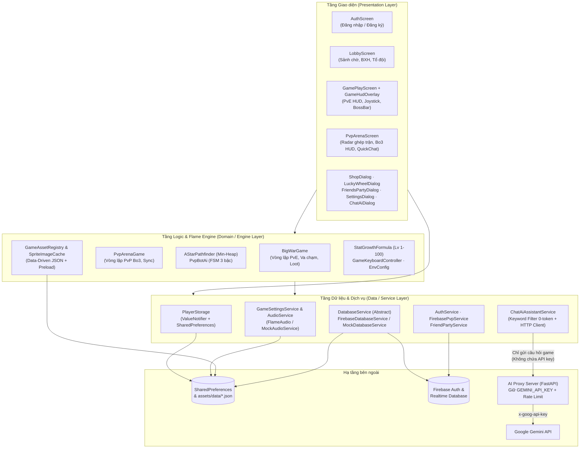

# 🏆 Big-War — 2D Pixel-Art Action RPG Mobile

> **Học phần:** `INT1449 · Lập trình di động`  
> **Chủ đề chính:** **Nhóm A — Game 2D với Flame · Chủ đề #2 (Quái đuổi bằng tìm đường A\*)** *(tích hợp trọn vẹn tính năng cốt lõi của #1 Thu thập tài nguyên trên bản đồ ô)*  
> **Mở rộng nổi bật:** 5 bản đồ đọc từ JSON, Boss 2 pha, Đấu trường PvP 1v1/2v2/4v4 + Bot AI 3 bậc, Kết bạn/Tổ đội realtime, Âm thanh BGM/SFX, Bảng xếp hạng, 9 Tướng Level 1–100, 6 Trợ thủ AI và **Trợ lý AI theo mẫu Nhóm B (Máy chủ Proxy giữ khóa + Chế độ Demo offline)**.

-02569B?logo=flutter)


---

## 📑 Mục lục

1. [Mục đích & Tổng quan dự án](#1-mục-đích--tổng-quan-dự-án)
2. [Hệ thống tính năng nổi bật](#2-hệ-thống-tính-năng-nổi-bật)
3. [Bảng đối chiếu Rubric cuối kỳ & Điểm cộng](#3-bảng-đối-chiếu-rubric-cuối-kỳ--điểm-cộng)
4. [Kiến trúc hệ thống & Quản lý trạng thái](#4-kiến-trúc-hệ-thống--quản-lý-trạng-thái)
5. [Yêu cầu môi trường & Cài đặt nhanh (< 15 phút)](#5-yêu-cầu-môi-trường--cài-đặt-nhanh--15-phút)
6. [Cấu hình môi trường (KHÔNG chứa khóa bí mật)](#6-cấu-hình-môi-trường-không-chứa-khóa-bí-mật)
7. [Cách chạy ứng dụng & Đóng gói APK](#7-cách-chạy-ứng-dụng--đóng-gói-apk)
8. [Cách chạy kiểm thử, Phân tích tĩnh & CI/CD](#8-cách-chạy-kiểm-thử-phân-tích-tĩnh--cicd)
9. [Dữ liệu lưu ở đâu, Bảo mật & Quyền riêng tư](#9-dữ-liệu-lưu-ở-đâu-bảo-mật--quyền-riêng-tư)
10. [Hướng dẫn mở rộng nội dung Data-Driven (`assets/data/`)](#10-hướng-dẫn-mở-rộng-nội-dung-data-driven-assetsdata)
11. [Mục "Dùng AI"](#11-mục-dùng-ai)
12. [Kịch bản Demo & Chuẩn bị vấn đáp (15 phút)](#12-kịch-bản-demo--chuẩn-bị-vấn-đáp-15-phút)
13. [Danh sách nộp bài & Nhóm thực hiện](#13-danh-sách-nộp-bài--nhóm-thực-hiện)

---

## 1. Mục đích & Tổng quan dự án

**Big-War** là tựa game **2D Pixel-Art Action RPG** đa nền tảng (**Android & Web**) được xây dựng bằng **Flutter** và **Flame Engine (`1.38.2`)** của học phần `INT1449 · Lập trình di động`.

Mục tiêu của dự án là xây dựng một sản phẩm game di động hoàn chỉnh theo kiến trúc tách tầng rõ ràng, chạy mượt **60 FPS** trên điện thoại Android thật, hỗ trợ chơi **Offline-First** (không phụ thuộc mạng khi chơi PvE, Cửa hàng, Vòng quay, PvP với Bot và Trợ lý AI Demo) đồng thời mở rộng mượt mà sang **Online Realtime** (Đăng nhập Firebase Auth, Bảng xếp hạng, Kết bạn, Tổ đội Party 2v2/4v4, PvP thời gian thực và Trợ lý AI kết nối Gemini qua máy chủ FastAPI riêng).

### Ánh xạ khung 20 khối kiến thức Flutter (INT1449)

| Nhóm khối kiến thức | Ứng dụng cụ thể trong Big-War |
|---|---|
| **1. Dart · 16. Kiểm thử** | Thuật toán tìm đường **A\*** (Binary Min-Heap tự cài đặt), **PvP Bot AI FSM 3 bậc**, công thức tăng trưởng cấp độ 1–100, công thức Rank Sao/Elo và **60 test case** tự động (13 tệp). |
| **4. Bố cục · 6. Thích ứng · 10. Hoạt ảnh · 11. Trợ năng** | Màn ngang `sensorLandscape` fullscreen immersive, responsive `LayoutBuilder` cho màn nhỏ/lớn, hoạt ảnh Sprite & `CustomPainter`, kiểm thử trợ năng `meetsGuideline` (`>= 48 dp`, có nhãn). |
| **7. Tương tác · 8. Tài nguyên · 9. Điều hướng** | Virtual Joystick 360° + cụm nút kỹ năng cho Mobile, bộ phím `WASD/Arrows + 1/2/3/E/Space` cho Web/Desktop; kho tài nguyên Data-Driven (`assets/data/*.json`, ảnh sprite, 4 BGM, 11 SFX). |
| **12. Quản lý trạng thái · 13. Dữ liệu & Backend · 14. Kiến trúc** | Tách 3 tầng UI / Engine-Logic / Data-Services; reactive state bằng `ValueNotifier`; lưu trữ 2 lớp `SharedPreferences` (offline) + `Firebase Realtime Database` (online) có fallback an toàn. |
| **17. Hiệu năng · 18. Tích hợp nền tảng · 19. Triển khai · 20. AI** | Preload sprite nền chống ANR, giãn chu kỳ tính A\* chống nghẽn frame, `HapticFeedback`, build APK Release + Web PWA + CI GitHub Actions, Trợ lý AI 2 lớp qua **FastAPI Proxy giữ khóa**. |

---

## 2. Hệ thống tính năng nổi bật

### ⚔️ 2.1. Chế độ PvE Vượt Ải Hầm Ngục & AI Tìm Đường A\*
- **5 bản đồ đa chủ đề đọc từ JSON** ([assets/data/maps.json](assets/data/maps.json)): *Đấu Trường Băng Giá*, *Đảo Băng Tuyết*, *Rừng Cây Cổ Thụ*, *Điện Thờ Cổ Long*, *Hỏa Ngục Dung Nham* (lưới `36×24` ô, `tileSize = 32px`), có chướng ngại vật vật lý và va chạm tường.
- **Thuật toán tìm đường A\* tối ưu** ([lib/game/ai/astar_pathfinder.dart](lib/game/ai/astar_pathfinder.dart)):
  - Hàng đợi ưu tiên **Binary Min-Heap** tự viết (zero-dependency), heuristic khoảng cách **Octile** có tie-breaking.
  - Cơ chế **Line-of-Sight raycast** lấy mẫu `<= 8px` bỏ qua A\* khi không có vật cản (`< 0.02ms`).
  - **Chống cắt góc chéo** (Strict Corner-Cutting Prevention) giúp quái không bao giờ kẹt vào cột đá.
- **Hệ sinh thái quái vật & Boss 2 Pha**:
  - **Zombie** (cận chiến): bám đuổi bằng A\*, giãn chu kỳ tính lại đường (`0.45s` + random stagger) tối ưu CPU.
  - **Skeleton** (cung thủ tầm xa): **Kiting AI** giữ cự ly `110–240px`, tự lùi khi áp sát, tự đi vòng tìm góc bắn khi bị cột che.
  - **Boss Chúa Tể Hầm Ngục (2 Pha)** ([lib/game/components/boss_enemy.dart](lib/game/components/boss_enemy.dart)): `600 HP`, thanh máu động 2 lớp trên đỉnh HUD (`BossHealthBarOverlay`); Pha 1 đánh quét & dậm đất AoE có vùng báo trước `1.2s`; Pha 2 Cuồng Nộ tăng tốc, bắn cầu lửa 360° và triệu hồi viện binh tại mốc `70%` và `30%` HP; hạ gục rớt lượng lớn vàng & thắng màn.
- **Vật phẩm rơi (Pickups)**: Bình máu (`+HP`), Ngọc EXP (hút nam châm lên cấp trong trận), Xu vàng (`1 Xu = 1.000 Vàng`).

### 🏟️ 2.2. Đấu Trường PvP Rank (1v1 / 2v2 / 4v4) & Kết Bạn / Tổ Đội (Party)
- **3 chế độ thi đấu Best-of-3 (Bo3)** (`90 giây/hiệp`): **1v1 Đấu Đơn**, **2v2 Song Đấu**, **4v4 Quân Đoàn** trên đấu trường đối xứng `960×640px` (`30×20` ô) đồng bộ bản đồ xác định bằng thuật toán băm **FNV-1a** theo `roomId`.
- **Hệ thống Rank 7 bậc theo Sao + RP dùng chung**: *Đồng → Bạc → Vàng → Bạch Kim → Kim Cương* (3 sao/bậc) → *Huyền Thoại* (tích lũy sao) → *Thách Đấu* (**Top 10 nhiều sao nhất server**), kèm 7 huy hiệu PNG riêng (`assets/images/ranks/`).
- **PvP Bot AI 3 bậc độ khó thích ứng theo Rank** ([lib/game/ai/pvp_bot_ai.dart](lib/game/ai/pvp_bot_ai.dart)):
  - **Đồng / Bạc**: độ trễ phản xạ `0.6s`, sai số góc `50%`, tiếp cận đánh cơ bản.
  - **Vàng / Bạch Kim**: độ trễ `0.3s`, sai số `15%`, né chiêu `70%`, tung combo khi đối thủ cạn Ki.
  - **Kim Cương / Thách Đấu**: độ trễ `0.1s`, sai số `0%`, **đón đầu quỹ đạo (Predictive Aiming)**, thả diều (Kiting), combo 3 kỹ năng, né tường/trụ bằng A\* và tự thoát kẹt (Stuck Detection).
- **Kết bạn & Tổ đội Realtime** ([lib/services/friend_party_service.dart](lib/services/friend_party_service.dart)): tìm & gửi lời mời kết bạn theo **Mã ID (`GRxxxx`)**, hiển thị trạng thái Online/Offline realtime, mời vào phòng tổ đội có **popup tự đóng sau 5 giây**, đồng bộ trạng thái **Sẵn sàng** và vào cùng phòng đấu. Tự động bù AI Bot khi chơi offline hoặc hết thời gian chờ ghép trận.
- **Quick Chat 6 câu thoại mẫu** hiển thị bong bóng thoại trên đầu nhân vật trong `3 giây`.

### 🧙‍♂️ 2.3. Hệ thống 9 Nhân Vật, Level Vĩnh Viễn (1 → 100) & 6 Trợ Thủ AI
- **9 Nhân vật đa hệ** đọc từ [assets/data/heroes.json](assets/data/heroes.json) & [assets/data/skills.json](assets/data/skills.json):
  - *George* (Đấu Sĩ Búa — miễn phí), *Nova Blade* (Đấu Sĩ Neon), *Shadow* (Sát Thủ Hư Không), *Ember* (Pháp Sư Hỏa Cầu), *Valeria* (Pháp Sư Băng Hỏa), *Garrick* (Chiến Binh Cổ Đại), *Lyra* (Xạ Thủ), *Braum* (Hiệp Sĩ Khiên), *Hayate* (Ninja).
  - Mỗi nhân vật sở hữu **đòn đánh thường + bộ 3 kỹ năng chủ động** có cooldown và tiêu hao Ki riêng.
- **Hệ thống Cấp độ Thông Thạo vĩnh viễn (`Level 1 → 100`)** ([lib/core/stat_growth_formula.dart](lib/core/stat_growth_formula.dart)): nhận EXP sau mỗi trận PvE/PvP hoặc huấn luyện bằng Vàng, cộng vĩnh viễn `HP / Ki / ATK` theo hệ số tăng trưởng riêng từng hệ tướng.
- **6 Trợ Thủ AI Bay (Companions)** đọc từ [assets/data/companions.json](assets/data/companions.json): *Aegis-X9*, *Cyber Drone*, *Pyro-Frost Dragon*, *Gem-Tumbler*, *Luna Fox*, *ORBIT-03* — bay theo quỹ đạo quanh nhân vật, tự bắn hỗ trợ, kích hoạt kỹ năng đặc biệt (khiên hấp thụ sát thương, làm chậm, gom quái, thưởng vàng) và hút vật phẩm.

### 🪙 2.4. Kinh tế, Cửa Hàng, Vòng Quay May Mắn & Âm Thanh
- **Hệ thống kinh tế đồng nhất**: quy đổi 2 chiều **1 Xu = 1.000 Vàng** ngay tại Cửa hàng (`ShopDialog`) & Sảnh chờ.
- **Vòng Quay May Mắn 6 ô** (`0, 10, 20, 40, 50, 100 Xu Jackpot`): 1 lượt quay miễn phí mỗi ngày, tự động reset vào **00:00 UTC (07:00 sáng giờ Việt Nam)** kèm đồng hồ đếm ngược thời gian thực.
- **Âm thanh 2 lớp không crash** ([lib/services/audio_service.dart](lib/services/audio_service.dart)): **4 bản nhạc nền BGM** (*Sảnh chờ*, *Hầm ngục*, *Boss*, *PvP*) và **11 hiệu ứng SFX**; hàng đợi đồng bộ bất đồng bộ tránh race-condition khi bật/tắt nhạc nhanh, lưu tùy chọn vào `SharedPreferences`.

### 🤖 2.5. Trợ Lý Chat AI 2 Lớp (FastAPI Proxy giữ khóa + Chế độ Demo Offline)
- **Lớp 1 — Lọc từ khóa & Chặn ngoài lề tại Client (`< 1ms`, `0 token`)** ([lib/services/chat_ai_assistant_service.dart](lib/services/chat_ai_assistant_service.dart)): chuẩn hóa tiếng Việt có dấu & không dấu, trả lời tức thì 8 chủ đề FAQ cốt lõi của game và tự động từ chối câu hỏi ngoài phạm vi game Big-War.
- **Lớp 2 — Gọi AI Proxy Server (FastAPI)** ([server/ai_proxy/main.py](server/ai_proxy/main.py)): cho các câu hỏi mở về chiến thuật game, client gọi `POST /api/chat` **không hề gửi hay chứa khóa API**; máy chủ FastAPI giữ `GEMINI_API_KEY`, áp dụng **rate limit (`20 req/phút/IP`)**, giới hạn token (`maxOutputTokens: 220`) và `timeout 12s`.
- **Chế độ Demo Offline tự động**: nếu không cấu hình `AI_PROXY_URL` hoặc máy chủ không bật / mất mạng, ứng dụng tự động chuyển sang **Chế độ Demo (FAQ & Keyword Offline)** hoạt động hoàn hảo không lỗi.

### 🎮 2.6. Điều khiển đa nền tảng
- **Android / Cảm ứng**: Virtual Joystick 360° (trái) + nút Đánh thường, 3 nút Kỹ năng, nút Kỹ năng Trợ thủ (phải) + phản hồi rung `HapticFeedback`.
- **Web / Desktop (bàn phím)**: `WASD` hoặc `Phím mũi tên` để di chuyển, `Space` / `J` đánh thường, `1` / `2` / `3` tung kỹ năng, `E` / `4` kích hoạt kỹ năng Trợ thủ.

---

## 3. Bảng đối chiếu Rubric cuối kỳ & Điểm cộng

| Tiêu chí Rubric (Trọng số) | Mức triển khai thực tế trong dự án | Tệp / Bằng chứng đối chiếu |
|---|---|---|
| **1. Chức năng theo đề (20đ)** | Đủ toàn bộ tính năng tối thiểu (bản đồ ô, va chạm tường, điểm, thắng/thua, lưu tiến trình, A\* tìm đường + test thuần, 5 màn đọc từ JSON) và **> 5 mở rộng lớn** (Boss 2 pha, PvP 1v1/2v2/4v4 + Bot AI 3 bậc, Kết bạn/Tổ đội realtime, Âm thanh BGM/SFX, Bảng xếp hạng, 9 Tướng Level 1–100, 6 Trợ thủ, Trợ lý AI Proxy). | [assets/data/](assets/data/), [lib/game/](lib/game/), [lib/screens/](lib/screens/) |
| **2. Giao diện & Trải nghiệm (15đ)** | Đủ 3 trạng thái **Đang tải**, **Lỗi**, **Chưa có dữ liệu**, mỗi trạng thái có lối ra (thử lại / hủy / fallback offline); bố cục thích ứng màn nhỏ & lớn (`LayoutBuilder`, `SafeArea`); vùng chạm `>= 48 dp` được kiểm thử tự động. | [auth_screen.dart](lib/screens/auth_screen.dart), [pvp_arena_screen.dart](lib/screens/pvp_arena_screen.dart), [chat_ai_dialog.dart](lib/screens/chat_ai_dialog.dart), [accessibility_guideline_test.dart](test/accessibility_guideline_test.dart) |
| **3. Kiến trúc & Quản lý trạng thái (15đ)** | Tách rõ 3 tầng UI (`screens/`, `game/hud/`), Logic/Engine (`game/`, `core/`, `registry/`), Dữ liệu (`models/`, `services/`); hỗ trợ inject mock/fake (`DatabaseService.setInstance`, `AudioService.setInstance`, `BgmPlayback`, `http.Client`); không gọi mạng trong `build()`; `dispose()` đầy đủ controller/subscription/timer. | [database_service.dart](lib/services/database_service.dart), [audio_service.dart](lib/services/audio_service.dart), [chat_ai_assistant_service.dart](lib/services/chat_ai_assistant_service.dart) |
| **4. Dữ liệu, mạng & xử lý lỗi (10đ)** | `SharedPreferences` (offline) + `Firebase Realtime Database` (online) + JSON cấu hình; mọi gọi mạng có timeout (`12s` AI Proxy, `500ms`/`20s` matchmaking) và thông báo tiếng Việt thân thiện (`AuthService._mapAuthError`); JSON hỏng / mất mạng tự fallback an toàn, không crash app. | [player_storage.dart](lib/services/player_storage.dart), [auth_service.dart](lib/services/auth_service.dart), [firebase_database_service.dart](lib/services/firebase_database_service.dart) |
| **5. Kiểm thử (10đ)** | **60 test case có ý nghĩa (60/60 pass)** vượt xa yêu cầu `>= 15`, bao gồm unit test cho A\*, Bot AI, AI Proxy, Audio race-condition, Companion, Kinh tế PvE, Rank và **13 widget test** cho luồng chính (`AuthScreen`, `LobbyScreen`, `PvpArenaScreen`, `EditProfileDialog`, `ChatAiDialog`, `OrientationGuard`, `GameWidget`). | [test/](test/) (13 tệp kiểm thử) |
| **6. Bảo mật & Quyền riêng tư (10đ)** | Không hardcode bất kỳ khóa API/mật khẩu nào trong mã nguồn (`EnvConfig` mặc định rỗng, được kiểm chứng bằng unit test); `GEMINI_API_KEY` **chỉ nằm ở máy chủ** `server/ai_proxy/.env`; `.env`, `google-services.json`, `*.jks`, `android/key.properties` đều được `.gitignore`; Android chỉ xin 2 quyền tối thiểu (`INTERNET`, `ACCESS_NETWORK_STATE`); `database.rules.json` phân quyền chặt theo `auth.uid`. | [env_config.dart](lib/core/env_config.dart), [AndroidManifest.xml](android/app/src/main/AndroidManifest.xml), [database.rules.json](database.rules.json), [server/ai_proxy/main.py](server/ai_proxy/main.py) |
| **7. Tài liệu & Quy trình làm việc (10đ)** | README đầy đủ giúp cài và chạy trong `< 15 phút`; `flutter analyze` đạt **0 lỗi / 0 cảnh báo**; lịch sử Git có commit đều đặn từ các thành viên kèm Pull Request. | [README.md](README.md), `git log` |
| **8. Trình bày, Demo & Vấn đáp (10đ)** | Có kịch bản demo máy thật (luồng chính + lỗi + rỗng) và tài liệu giải thích kiến trúc / trả lời 6 câu hỏi vấn đáp ở Mục 12. | [Mục 12](#12-kịch-bản-demo--chuẩn-bị-vấn-đáp-15-phút) |

### Các hạng mục Điểm cộng đã tích hợp
- **+3 điểm — Mở rộng AI đúng mẫu máy chủ giữ khóa + Chế độ Demo**: Máy chủ FastAPI ([server/ai_proxy/main.py](server/ai_proxy/main.py)) giữ `GEMINI_API_KEY` + rate-limit; ứng dụng Flutter chỉ gọi `/api/chat` qua `AI_PROXY_URL` và tự chạy **Demo Mode** khi không có khóa/server.
- **+2 điểm — CI tự chạy `flutter analyze` và `flutter test`**: Cấu hình tại [.github/workflows/ci.yml](.github/workflows/ci.yml) kích hoạt tự động trên mỗi lần `push` và `pull_request` vào `main`/`master` (kèm workflow deploy Web tại [.github/workflows/deploy_web.yml](.github/workflows/deploy_web.yml) và build iOS tại [.github/workflows/ios_build.yml](.github/workflows/ios_build.yml)).
- **+2 điểm — Kiểm thử trợ năng bằng `meetsGuideline`**: [test/accessibility_guideline_test.dart](test/accessibility_guideline_test.dart) kiểm chứng cả `androidTapTargetGuideline` (`>= 48×48 dp`) và `labeledTapTargetGuideline`.
- **+2 điểm — Phát hành bản cài thử APK Release ký bằng khóa riêng & Web Hosting**: [android/app/build.gradle.kts](android/app/build.gradle.kts) cấu hình ký release bằng keystore riêng (`android/key.properties`, mẫu tại [android/key.properties.example](android/key.properties.example)), script [build_apk.bat](build_apk.bat) xuất `build/app/outputs/flutter-apk/app-release.apk`, đồng thời tự động phát hành bản Web tại **Firebase Hosting** (`https://my-game-ec4fa.web.app`) và **GitHub Pages**.

---

## 4. Kiến trúc hệ thống & Quản lý trạng thái

### 4.1. Sơ đồ kiến trúc 3 tầng



### 4.2. Cấu trúc thư mục dự án

```text
my-game/
├── .github/workflows/
│   ├── ci.yml                        # GitHub Actions: tự chạy flutter analyze & flutter test
│   ├── deploy_web.yml                # Tự động build & deploy Web lên GitHub Pages & Firebase Hosting
│   └── ios_build.yml                 # Workflow đóng gói iOS IPA trên macOS runner
├── assets/
│   ├── audio/                        # 4 BGM (.mp3) & 11 SFX (.wav)
│   ├── data/                         # Cấu hình Data-Driven (heroes, skills, companions, enemies, maps).json
│   └── images/                       # Sprite tướng (nova, ember, shadow), trợ thủ, 5 map, 7 huy hiệu rank, UI
├── lib/
│   ├── main.dart                     # Điểm khởi chạy: khóa landscape, nạp Registry/Firebase/Storage/Audio
│   ├── firebase_options.dart         # Cấu hình Firebase đọc qua EnvConfig (--dart-define)
│   ├── core/                         # Constants, EnvConfig, StatGrowthFormula (Lv 1-100), KeyboardController
│   ├── models/                       # PlayerProfile, PvpMatch/PvpRankSystem, DatabaseModels, FriendPartyModels
│   ├── registry/                     # GameAssetRegistry (đọc JSON), SpriteImageCache (preload nền)
│   ├── game/
│   │   ├── big_war_game.dart         # Engine màn chơi PvE (BigWarGame)
│   │   ├── pvp_arena_game.dart       # Engine Đấu trường PvP 1v1 / 2v2 / 4v4
│   │   ├── ai/                       # astar_pathfinder.dart, pvp_bot_ai.dart
│   │   ├── components/               # Player, Zombie, Skeleton, Boss, Companion, Map, Projectiles, Pickups
│   │   └── hud/                      # GameHudOverlay, BossHealthBarOverlay, VirtualJoystick
│   ├── screens/                      # Auth, Lobby, GamePlay, PvpArena + 5 Dialogs + widgets/
│   └── services/                     # Auth, Database (Abstract/Firebase/Mock), FirebasePvp, FriendParty,
│                                     # PlayerStorage, AudioService, GameSettings, ChatAiAssistant
├── server/ai_proxy/                  # Máy chủ FastAPI giữ GEMINI_API_KEY & rate limiting
│   ├── main.py
│   ├── requirements.txt
│   ├── .env.example
│   └── README.md
├── test/                             # 13 tệp kiểm thử (60 unit test, widget test & accessibility test)
├── tool/                             # Công cụ sinh asset âm thanh & bản đồ
├── android/                          # Cấu hình Android + key.properties.example (ký APK release)
├── ios/ & web/                       # Mã cấu hình iOS & Web PWA
├── database.rules.json               # Quy tắc bảo mật Firebase Realtime Database
├── firebase.json                     # Cấu hình Firebase Hosting (Web PWA) & RTDB rules
├── .env.example                      # Mẫu biến môi trường (KHÔNG chứa khóa thật)
├── run_android.bat                   # Script chạy nhanh trên Android Emulator
├── run_chrome.bat                    # Script chạy nhanh trên Chrome Web
└── build_apk.bat                     # Script đóng gói APK Release cho Android
```

### 4.3. Quản lý trạng thái, Khả năng thay thế phụ thuộc & Xử lý 3 trạng thái UX

- **Quản lý trạng thái tập trung**: dùng `ValueNotifier` (`PlayerStorage.profileNotifier`, `FriendPartyService.partyNotifier` / `friendsNotifier` / `incomingInviteNotifier`, `AudioService.*Notifier`, `GameSettingsService.*Notifier`, `BigWarGame.bossHpNotifier`) giúp UI cập nhật phản ứng tức thì, không gọi mạng trong `build()` và `dispose()` đầy đủ mọi controller/subscription/timer.
- **Thay thế phụ thuộc bằng đồ giả (Testable Architecture)**:
  - `DatabaseService.setInstance(MockDatabaseService())`
  - `AudioService.setInstance(MockAudioService())` và `FlameAudioService(bgmPlayback: fakePlayback)`
  - `ChatAiAssistantService.instance.generateReplyAsync(..., client: MockClient(...))`
  - `EnvConfig.setTestOverrides(...)` trong unit test.
- **Đầy đủ 3 trạng thái UX kèm lối ra**:
  - **Đang tải (Loading)**: nút đăng nhập/đăng ký hiển thị spinner khóa double-tap (`AuthScreen`); màn hình Radar tìm trận PvP kèm bộ đếm thời gian và nút **HỦY TÌM / GHÉP NGAY (AI BOT)** (`PvpArenaScreen`); trạng thái AI đang suy nghĩ (`ChatAiDialog`).
  - **Lỗi (Error)**: thông báo lỗi tiếng Việt thân thiện trên `AuthScreen` (sai mật khẩu, email đã tồn tại, mất mạng...) cho phép sửa & gửi lại ngay; lỗi AI Proxy / timeout `12s` tự rơi về **Chế độ Demo Offline** không chặn người dùng; lỗi Firebase tự chuyển về `MockDatabaseService` (offline).
  - **Chưa có dữ liệu (Empty)**: danh sách bạn bè trống / chưa có lời mời kết bạn / bảng xếp hạng trống đều hiển thị hướng dẫn rõ ràng + nút hành động (mời theo mã ID, bắt đầu chơi để ghi điểm).

---

## 5. Yêu cầu môi trường & Cài đặt nhanh (< 15 phút)

### Yêu cầu hệ thống
- **Flutter SDK**: `>= 3.24` (khuyên dùng bản stable mới nhất đi kèm **Dart SDK `^3.13.5`**; CI đang chạy trên Flutter `3.47.7`).
- **Android Studio / Android SDK** (JDK 17) — để chạy trên điện thoại Android thật hoặc máy ảo Android.
- **Google Chrome** *(tùy chọn)* — để chạy thử nhanh trên Web.
- **Python 3.10+** *(tùy chọn)* — chỉ cần nếu muốn chạy máy chủ AI Proxy gọi Gemini thật; **không bắt buộc** vì game chạy được ngay ở **Chế độ Demo Offline**.

### Các bước cài đặt

```bash
# 1. Clone mã nguồn
git clone https://github.com/TolaTien/My-game.git
cd My-game

# 2. Kiểm tra môi trường Flutter & thiết bị kết nối
flutter doctor
flutter devices

# 3. Cài đặt toàn bộ gói phụ thuộc
flutter pub get
```

---

## 6. Cấu hình môi trường (KHÔNG chứa khóa bí mật)

Dự án tuân thủ nghiêm ngặt quy tắc **không lưu khóa bí mật / mật khẩu trong mã nguồn, lịch sử Git hay gói cài đặt APK**:
- Tệp `.env` và `server/ai_proxy/.env` đều đã được khai báo trong [.gitignore](.gitignore).
- Tệp `.env` **không** được khai báo trong `flutter: assets:` của [pubspec.yaml](pubspec.yaml), nên không bao giờ bị đóng gói thành tệp văn bản trong APK/Web bundle.
- Toàn bộ cấu hình runtime được truyền vào lúc biên dịch thông qua `--dart-define` / `--dart-define-from-file=.env` (đọc tại [lib/core/env_config.dart](lib/core/env_config.dart)).

### 6.1. Cấu hình ứng dụng Flutter (tùy chọn)

```bash
# Windows (PowerShell / CMD)
copy .env.example .env

# macOS / Linux
cp .env.example .env
```

Nội dung mẫu trong [.env.example](.env.example):

```env
# Địa chỉ máy chủ AI Proxy (để trống để chạy Chế độ Demo Offline — không cần khóa)
AI_PROXY_URL=

# Cấu hình Firebase (truyền qua --dart-define-from-file=.env khi build/run)
FIREBASE_API_KEY=your_firebase_api_key_here
FIREBASE_AUTH_DOMAIN=your-project.firebaseapp.com
FIREBASE_APP_ID_WEB=your_firebase_web_app_id
FIREBASE_APP_ID_ANDROID=your_firebase_android_app_id
FIREBASE_DATABASE_URL=https://your-project-default-rtdb.asia-southeast1.firebasedatabase.app
FIREBASE_PROJECT_ID=your-project-id
FIREBASE_MESSAGING_SENDER_ID=your_messaging_sender_id
```

> **Lưu ý:**
> - Nếu để trống `AI_PROXY_URL`: Trợ lý AI tự động hoạt động ở **Chế độ Demo Offline** (lọc từ khóa + 8 chủ đề FAQ) mà không cần khóa API hay máy chủ.
> - Nếu không kết nối mạng / chưa cấu hình Firebase: game vẫn chạy bình thường chế độ PvE, Cửa hàng, Vòng quay và PvP với Bot AI bằng dữ liệu cục bộ `SharedPreferences`.

### 6.2. Cấu hình & khởi chạy Máy chủ AI Proxy giữ khóa Gemini (tùy chọn)

Khóa `GEMINI_API_KEY` **chỉ tồn tại trên máy chủ backend** tại `server/ai_proxy/.env` (xem thêm [server/ai_proxy/README.md](server/ai_proxy/README.md)):

```bash
cd server/ai_proxy
python -m venv .venv

# Windows:
.venv\Scripts\activate
# macOS / Linux:
# source .venv/bin/activate

pip install -r requirements.txt
copy .env.example .env    # Mở server/ai_proxy/.env và điền GEMINI_API_KEY thật của bạn
uvicorn main:app --host 0.0.0.0 --port 8000 --reload
```

Kiểm tra nhanh trạng thái máy chủ tại: `http://localhost:8000/health`.

---

## 7. Cách chạy ứng dụng & Đóng gói APK

### 7.1. Chạy trên điện thoại Android thật (khuyến nghị khi demo)
Bật **USB Debugging** trên điện thoại Android, cắm cáp USB và chạy:

```bash
# Chạy nhanh không cần khóa (Chế độ Demo AI)
flutter run

# Chạy có nạp cấu hình từ tệp .env cục bộ
flutter run --dart-define-from-file=.env

# Chạy kết nối tới AI Proxy đang bật trên máy tính (thay <IP_LAN> bằng IP máy tính cùng Wi-Fi)
flutter run --dart-define-from-file=.env --dart-define=AI_PROXY_URL=http://<IP_LAN>:8000
```

### 7.2. Chạy trên Android Emulator
```bash
# Trên Android Emulator, 10.0.2.2 trỏ về localhost của máy host
flutter run --dart-define=AI_PROXY_URL=http://10.0.2.2:8000

# Hoặc chạy trực tiếp script có sẵn trên Windows:
.\run_android.bat
```

### 7.3. Chạy trên trình duyệt Chrome (Web)
```bash
flutter run -d chrome --dart-define-from-file=.env
# Hoặc nối với AI Proxy cục bộ:
flutter run -d chrome --dart-define=AI_PROXY_URL=http://localhost:8000

# Hoặc chạy nhanh trên Windows:
.\run_chrome.bat
```

> **Mẹo test PvP Online 2 người trên 1 máy tính**: mở 2 tab Chrome với 2 tài khoản khác nhau (`FirebaseAuth` trên Web dùng `Persistence.SESSION` tách biệt theo từng tab), cả 2 cùng bấm **TÌM TRẬN RANK** hoặc tạo **Tổ đội (Party)** để đấu trực tiếp thời gian thực.

### 7.4. Đóng gói tệp APK Release ký bằng khóa riêng cho Android

Để ký APK release bằng khóa riêng (keystore — không commit lên Git):
1. Sao chép [android/key.properties.example](android/key.properties.example) thành `android/key.properties` và điền thông tin keystore của bạn (tạo mới bằng `keytool -genkeypair ...`).
2. Nếu chưa tạo `android/key.properties` trên máy mới, Gradle tự fallback sang `debug` key để vẫn build thử được mà không lỗi.

```bash
# Đóng gói có nạp cấu hình từ .env (nếu có)
flutter build apk --release --no-tree-shake-icons --dart-define-from-file=.env

# Hoặc chạy script Windows:
.\build_apk.bat
```

Tệp APK đầu ra nằm tại:
`build/app/outputs/flutter-apk/app-release.apk`

Cài đặt trực tiếp sang điện thoại Android qua ADB:
```bash
adb install -r build/app/outputs/flutter-apk/app-release.apk
```

---

## 8. Cách chạy kiểm thử, Phân tích tĩnh & CI/CD

### 8.1. Lệnh kiểm tra cục bộ

```bash
# 1. Phân tích tĩnh toàn dự án (kết quả hiện tại: No issues found!)
flutter analyze

# 2. Chạy toàn bộ 60 unit test, widget test & accessibility test
flutter test --reporter expanded
```

### 8.2. Danh sách 13 bộ kiểm thử tự động (60/60 test case đạt)

| STT | Tệp kiểm thử | Loại test | Nội dung kiểm chứng trọng tâm |
|:---:|---|---|---|
| 1 | [test/accessibility_guideline_test.dart](test/accessibility_guideline_test.dart) | Widget + Accessibility (1) | Kiểm chứng `ChatAiDialog` đạt chuẩn `androidTapTargetGuideline` (`>= 48dp`) và `labeledTapTargetGuideline` qua `meetsGuideline`. |
| 2 | [test/auth_screen_layout_test.dart](test/auth_screen_layout_test.dart) | Widget (2) | Kiểm chứng bố cục `AuthScreen` trên màn hình nhỏ/lớn không tràn viền (`overflow`), hiển thị đủ trạng thái đăng nhập/đăng ký. |
| 3 | [test/bgm_settings_regression_test.dart](test/bgm_settings_regression_test.dart) | Unit (6) | Xử lý race-condition khi bật/tắt BGM lúc đang tải nhạc, kéo thanh âm lượng về `0`, lưu trạng thái mute qua `SharedPreferences`, `stopBgm` không bị ghi đè bởi tác vụ cũ. |
| 4 | [test/chat_ai_assistant_test.dart](test/chat_ai_assistant_test.dart) | Unit (6) | Kiểm chứng `EnvConfig` **không hardcode khóa Firebase/AI**, lọc từ khóa tiếng Việt không dấu (0 token), chặn câu hỏi ngoài lề (0 token), gọi `/api/chat` không gửi `x-goog-api-key`, tự fallback **Demo Mode** khi lỗi/rỗng URL. |
| 5 | [test/companion_regression_test.dart](test/companion_regression_test.dart) | Unit + Widget (8) | Khiên trợ thủ hết hạn giữ nguyên phòng thủ bị động (4 trợ thủ), reset khi đổi tầng/gỡ bỏ, không gọi miễn phí khi chưa trang bị, kiểm chứng render tia laser & sát thương đạn Plasma trên `GameWidget`. |
| 6 | [test/lobby_companion_animation_test.dart](test/lobby_companion_animation_test.dart) | Unit + Widget (9) | Kiểm chứng hoạt ảnh bay lơ lửng, hiệu ứng hạt và hiển thị từng trợ thủ trên `LobbyScreen`. |
| 7 | [test/orientation_guard_test.dart](test/orientation_guard_test.dart) | Widget (2) | Kiểm chứng `OrientationGuard` hiển thị nhắc xoay ngang khi thiết bị ở chế độ dọc (`portrait`) và mở khóa khi xoay ngang (`landscape`). |
| 8 | [test/party_invite_popup_test.dart](test/party_invite_popup_test.dart) | Unit + Widget (2) | Gửi lời mời tổ đội không tự ý thêm người chưa đồng ý; kiểm chứng popup lời mời tổ đội xuất hiện trên `LobbyScreen` và tự đóng sau 5 giây. |
| 9 | [test/pve_coin_reward_test.dart](test/pve_coin_reward_test.dart) | Unit (6) | Kiểm chứng công thức thưởng Xu/Vàng PvE, tỷ lệ quy đổi `1 Xu = 1.000 Vàng`, cộng dồn hồ sơ người chơi không âm/không thất thoát. |
| 10 | [test/pvp_bot_and_lobby_test.dart](test/pvp_bot_and_lobby_test.dart) | Unit + Widget (8) | Lưới đi được PvP (`30×20`, tường & 4 trụ), **A\* vòng qua cột trụ**, Bot chờ hết `roundIntro` rồi tránh trụ & tấn công, chuyển mục tiêu khi địch bị hạ, sinh đội hình tất định theo seed, kiểm chứng UI `LobbyScreen` & `PvpArenaScreen` (tự ghép Bot offline, khách sẵn sàng & vào cùng phòng chủ phòng). |
| 11 | [test/pvp_start_responsiveness_test.dart](test/pvp_start_responsiveness_test.dart) | Unit (3) | Đồng bộ cùng bản đồ giữa 2 người chơi theo `roomId` (FNV-1a), chia sẻ chung danh sách vật cản, giữ phím di chuyển trong `roundIntro` kích hoạt ngay ở frame đầu của `fighting`. |
| 12 | [test/rank_assets_and_profile_test.dart](test/rank_assets_and_profile_test.dart) | Unit + Widget (4) | Tồn tại đủ 7 tệp ảnh huy hiệu Rank PNG, ánh xạ `PlayerProfile.rankAssetPath`, hiển thị đúng huy hiệu/sao/RP/Top #1 Thách Đấu trên `EditProfileDialog`. |
| 13 | [test/removed_companion_test.dart](test/removed_companion_test.dart) | Unit (3) | Kiểm chứng tương thích ngược hồ sơ cũ khi một trợ thủ bị gỡ khỏi danh mục, không làm crash app khi đọc `SharedPreferences`. |

### 8.3. Tích hợp liên tục (GitHub Actions CI/CD)
- [.github/workflows/ci.yml](.github/workflows/ci.yml): Tự động cài Flutter, chạy `flutter pub get`, `flutter analyze --no-fatal-infos` và `flutter test --reporter expanded` mỗi lần `push` hoặc mở `Pull Request` vào `main`/`master`.
- [.github/workflows/deploy_web.yml](.github/workflows/deploy_web.yml): Tự động kiểm thử, biên dịch bản Web với `FIREBASE_API_KEY` lấy từ **GitHub Secrets** và triển khai lên **GitHub Pages** & **Firebase Hosting** (`https://my-game-ec4fa.web.app`).
- [.github/workflows/ios_build.yml](.github/workflows/ios_build.yml): Hỗ trợ biên dịch tự động bản iOS trên macOS runner.

---

## 9. Dữ liệu lưu ở đâu, Bảo mật & Quyền riêng tư

### 9.1. Bảng vị trí lưu trữ toàn bộ dữ liệu

| Loại dữ liệu | Vị trí lưu trữ | Mục đích & Vòng đời |
|---|---|---|
| **Hồ sơ người chơi cục bộ** (tên, mã `GRxxxx`, Vàng, Xu, Tỉ lệ thắng, Rank Sao/RP, tướng & trợ thủ đã mở, cấp độ tướng 1–100, mốc quay thưởng `lastSpinTimestamp`) | Thiết bị người dùng — `SharedPreferences` (khóa `big_war_player_profile` hoặc `big_war_player_profile_<uid>`) | Chơi Offline-First không mất tiến trình khi tắt app; tách riêng từng tài khoản để không lẫn dữ liệu khi đổi tài khoản. |
| **Cài đặt âm thanh & đồ họa/điều khiển** (`targetFps`, `graphicsQuality`, bật/tắt số sát thương, auto-aim, rung haptic, rung màn hình, âm lượng/tắt BGM & SFX) | Thiết bị người dùng — `SharedPreferences` | Khôi phục ngay khi mở lại ứng dụng (`AudioService`, `GameSettingsService`). |
| **Bộ nhớ đệm BXH & Tổ đội cục bộ** | Thiết bị người dùng — `SharedPreferences` (`big_war_mock_leaderboard`, `big_war_shared_*`) | Dự phòng mượt mà khi tắt mạng hoặc chạy test/offline. |
| **Tài khoản đăng nhập** (Email, UID, DisplayName) | **Firebase Authentication** | Xác thực đăng nhập/đăng ký, hỗ trợ quên mật khẩu; phiên trên Web dùng `Persistence.SESSION`. |
| **Dữ liệu Online Realtime** (`players/{uid}`, `leaderboard`, `matchmaking`, `rooms/{roomId}`, `directory`, `parties`, `invitations`, `friend_requests`, `friendships`) | **Firebase Realtime Database** (bảo vệ bởi [database.rules.json](database.rules.json)) | Đồng bộ hồ sơ đám mây (debounce `800ms`), BXH Top server, kết bạn, tổ đội và phòng PvP thời gian thực. |
| **Cấu hình game tĩnh** (tướng, kỹ năng, trợ thủ, quái vật, 5 bản đồ) | Đóng gói chỉ đọc trong ứng dụng (`assets/data/*.json`) | Tách dữ liệu khỏi code engine (`GameAssetRegistry`), có fallback mặc định nếu JSON lỗi. |
| **Lịch sử hội thoại Trợ lý AI** | Bộ nhớ tạm **RAM** trong phiên mở `ChatAiDialog` | Chỉ giữ trong phiên trò chuyện (gửi tối đa 2 tin gần nhất làm ngữ cảnh), tự giải phóng khi đóng hộp thoại, không lưu đĩa hay chia sẻ bên thứ ba. |
| **Khóa bí mật `GEMINI_API_KEY`** | **Chỉ nằm trên máy chủ** `server/ai_proxy/.env` | Tuyệt đối không đưa vào mã nguồn Flutter, Git hay APK. |

### 9.2. Phân quyền dữ liệu trên Firebase (`database.rules.json`)
- Nút `players/$uid`: chỉ chủ tài khoản đã xác thực (`auth != null && auth.uid == $uid`) mới có quyền đọc/ghi; có quy tắc `.validate` kiểm tra kiểu dữ liệu (`gold >= 0`, `displayName` dài `1..32` ký tự).
- Các nút `matchmaking`, `rooms`, `directory`, `parties`, `invitations`, `friend_requests`, `friendships`: yêu cầu `auth != null`.
- Nút `leaderboard`: cho phép đọc công khai (`.read: true`), chỉ ghi khi đã đăng nhập (`auth != null`).

### 9.3. Quyền Android khai báo (`AndroidManifest.xml`)
Ứng dụng tuân thủ nguyên tắc **quyền tối thiểu** — chỉ khai báo đúng **2 quyền mạng cơ bản**, không yêu cầu quyền nhạy cảm (không Camera, không Vị trí, không Danh bạ, không Bộ nhớ ngoài):
- `android.permission.INTERNET`: kết nối Firebase Auth / Realtime Database và AI Proxy Server (khi bật).
- `android.permission.ACCESS_NETWORK_STATE`: nhận biết trạng thái kết nối mạng để tự chuyển sang chế độ Offline Fallback.

---

## 10. Hướng dẫn mở rộng nội dung Data-Driven (`assets/data/`)

Nhờ kiến trúc `GameAssetRegistry` ([lib/registry/asset_registry.dart](lib/registry/asset_registry.dart)), có thể bổ sung nội dung game mà không cần sửa vòng lặp lõi:
1. **Thêm Nhân vật mới**: chép ảnh sprite/portrait vào `assets/images/heroes/<hero_id>/` và thêm mục JSON vào [assets/data/heroes.json](assets/data/heroes.json) + 3 kỹ năng vào [assets/data/skills.json](assets/data/skills.json).
2. **Thêm Bản đồ mới**: chép ảnh nền vào `assets/images/maps/` và khai báo tọa độ `playerSpawn`, `bossSpawn`, `monsterPortals`, `obstacles` trong [assets/data/maps.json](assets/data/maps.json).
3. **Thêm Trợ thủ AI / Quái vật**: cập nhật [assets/data/companions.json](assets/data/companions.json) hoặc [assets/data/enemies.json](assets/data/enemies.json).

---

## 11. Mục "Dùng AI"

Trong quá trình thực hiện dự án, nhóm có sử dụng các trợ lý AI hỗ trợ phát triển phần mềm theo đúng quy định của học phần:

| Công cụ AI | Phạm vi hỗ trợ cụ thể |
|---|---|
| **Google Antigravity / Gemini** | Tư vấn tái cấu trúc kiến trúc 3 tầng (UI / Engine / Data), tối ưu thuật toán tìm đường **A\*** (Binary Min-Heap + chống cắt góc chéo) và **PvP Bot AI**, thiết kế máy chủ **FastAPI AI Proxy** giữ `GEMINI_API_KEY`, viết các bộ kiểm thử tự động (`unit`, `widget`, `accessibility`), rà soát bảo mật/khóa API, cấu hình ký APK Release & GitHub Actions CI/CD, hoàn thiện tài liệu `README.md`. |
| **AI tạo ảnh / sinh asset hỗ trợ** | Tạo bản nháp hình ảnh bản đồ pixel-art, huy hiệu bậc Rank và minh họa trợ thủ (sau đó được nhóm chỉnh sửa, cắt chuẩn kích thước và kiểm tra hiển thị thực tế trong game). |

### Nguyên tắc kiểm soát & minh bạch
- **Không nộp mã chưa tự chạy thử:** Mọi đoạn mã có AI hỗ trợ đều được thành viên nhóm đọc hiểu, tự chỉnh sửa phù hợp kiến trúc và kiểm chứng bằng `flutter analyze` (`0 lỗi`), `flutter test` (`60/60 pass`) và chạy trực tiếp trên điện thoại Android thật / trình duyệt Web.
- **Giải thích được toàn bộ mã nguồn:** Mỗi thành viên chịu trách nhiệm nắm rõ logic các tệp mình phụ trách để trả lời vấn đáp.
- **Lưu vết hội thoại:** Các đoạn hội thoại quan trọng với trợ lý AI được lưu tại thư mục `docs/ai/`.

---

## 12. Kịch bản Demo & Chuẩn bị vấn đáp (15 phút)

### 12.1. Phần 1 — Demo trên điện thoại Android thật (5 phút)
1. **Luồng chính (Happy Path):**
   - Mở app → màn `AuthScreen` (chế độ ngang `sensorLandscape`) → Đăng nhập (hoặc Chơi ngay Offline) vào `LobbyScreen`.
   - Mở **Cửa hàng / Nâng cấp Tướng / Chọn Trợ thủ**, quay **Vòng quay may mắn**, mở **Bảng xếp hạng**.
   - Vào **PvE Vượt Ải Hầm Ngục**: di chuyển bằng Virtual Joystick, tung 3 kỹ năng + kỹ năng Trợ thủ, cho thấy Zombie/Skeleton tìm đường **A\*** vòng qua cột đá và hạ gục **Boss 2 pha** nhận vàng/EXP.
   - Vào **PvP Rank (1v1/2v2/4v4)**: ghép trận đấu Bo3 với người chơi khác hoặc Bot AI, dùng Quick Chat và xem cập nhật Rank Sao/RP.
   - Mở **Trợ lý Chat AI**: hỏi câu FAQ trong game (phản hồi tức thì `< 1ms`, 0 token) và hỏi câu ngoài lề (bị từ chối tại client).
2. **Trạng thái lỗi (Error State):**
   - Nhập sai mật khẩu hoặc tắt Wi-Fi/4G khi đăng nhập → hiển thị thông báo lỗi tiếng Việt thân thiện, cho phép sửa/thử lại ngay, không crash app.
   - Tắt máy chủ AI Proxy (hoặc tắt mạng) khi hỏi câu chiến thuật → tự động chuyển về **Chế độ Demo Offline** mượt mà.
3. **Trạng thái chưa có dữ liệu (Empty State):**
   - Mở hộp thoại **Bạn bè / Tổ đội** với tài khoản mới → hiển thị trạng thái rỗng rõ ràng kèm hướng dẫn nhập mã `GRxxxx` để kết bạn/mời tổ đội.

### 12.2. Phần 2 — Giải thích mã nguồn ngẫu nhiên (5 phút)
Mỗi thành viên sẵn sàng mở và giải thích trực tiếp luồng dữ liệu, vòng đời widget (`initState`/`dispose`) và thuật toán trong các tệp mình phụ trách (`lib/game/ai/astar_pathfinder.dart`, `lib/game/big_war_game.dart`, `lib/game/pvp_arena_game.dart`, `lib/services/player_storage.dart`, `lib/services/chat_ai_assistant_service.dart`, `server/ai_proxy/main.py`...).

### 12.3. Phần 3 — Trả lời nhanh 6 câu hỏi gợi ý vấn đáp (5 phút)
1. **Nếu tắt mạng giữa lúc đang lưu, app xử lý thế nào?**  
   `PlayerStorage` luôn lưu **cục bộ vào `SharedPreferences` trước** (Offline-First), sau đó mới đồng bộ nền lên Firebase Realtime Database (có debounce `800ms` và bắt lỗi `try/catch`). Nếu mất mạng giữa chừng, dữ liệu cục bộ không bị mất, app không crash và sẽ tự đồng bộ lại ở lần lưu có mạng tiếp theo.
2. **Trạng thái của màn hình này nằm ở đâu, ai được thay đổi nó?**  
   Trạng thái dùng chung nằm tập trung ở tầng dịch vụ qua `ValueNotifier` (`PlayerStorage.profileNotifier`, `FriendPartyService.partyNotifier`, `AudioService.*Notifier`, `GameSettingsService.*Notifier`). UI chỉ lắng nghe (`ValueListenableBuilder`) và gọi hàm nghiệp vụ của service để thay đổi trạng thái — không tự sửa dữ liệu phân tán bằng `setState` chéo màn hình.
3. **Muốn đổi cách lưu trữ sang một cơ sở dữ liệu khác, nhóm phải sửa những tệp nào?**  
   Nhờ tách interface trừu tượng [DatabaseService](lib/services/database_service.dart), chỉ cần viết 1 lớp triển khai mới (ví dụ `SupabaseDatabaseService` hoặc `SqliteDatabaseService`) kế thừa `DatabaseService` và đổi điểm đăng ký tại `main.dart` / `DatabaseService.setInstance(...)` — **không cần sửa bất kỳ màn hình UI hay vòng lặp game Flame nào**.
4. **Test nào bắt được lỗi thật trong quá trình làm? Kể một lần như vậy.**  
   - [test/bgm_settings_regression_test.dart](test/bgm_settings_regression_test.dart) bắt được lỗi **race-condition**: người dùng bấm tắt nhạc ngay khi file BGM đang tải bất đồng bộ khiến nhạc tự phát lại sau khi tải xong; đã sửa bằng hàng đợi đồng bộ trạng thái âm thanh.
   - [test/companion_regression_test.dart](test/companion_regression_test.dart) bắt được lỗi khiên trợ thủ hết thời gian bị xóa nhầm luôn chỉ số phòng thủ bị động gốc của nhân vật.
5. **App xin những quyền gì, vào lúc nào, vì sao?**  
   Ứng dụng chỉ khai báo đúng **2 quyền mạng tối thiểu** trong [AndroidManifest.xml](android/app/src/main/AndroidManifest.xml) là `INTERNET` (kết nối Firebase & AI Proxy) và `ACCESS_NETWORK_STATE` (nhận biết trạng thái mạng để fallback offline). Không xin bất kỳ quyền nhạy cảm runtime nào (Camera, Vị trí, Danh bạ, Bộ nhớ ngoài).
6. **Khoá API (nếu có) nằm ở đâu? Nếu ai đó giải nén APK thì thấy gì?**  
   - Khóa bí mật `GEMINI_API_KEY` **chỉ nằm trên máy chủ backend** `server/ai_proxy/.env` — giải nén APK hoàn toàn **không thấy khóa Gemini** (client chỉ biết URL proxy hoặc chạy Demo Mode).
   - File `.env` không được khai báo trong `pubspec.yaml` (`assets:`) nên không tồn tại tệp `.env` văn bản trong APK. Cấu hình Firebase runtime truyền qua `--dart-define-from-file=.env` lúc biên dịch, và dữ liệu Firebase được bảo vệ bằng **Firebase Auth + [database.rules.json](database.rules.json)** (`auth.uid == $uid`).

---

## 13. Danh sách nộp bài & Nhóm thực hiện

### Checklist 8 hạng mục nộp bài cuối kỳ
- [x] Link repo Git công khai / cấp quyền đọc cho giảng viên: `https://github.com/TolaTien/My-game`
- [x] `README.md` đầy đủ: mục đích, cài đặt, cấu hình không chứa khóa, cách chạy, cách chạy test, dữ liệu lưu ở đâu, mục "Dùng AI", kịch bản Demo & Vấn đáp
- [x] Tệp APK cài đặt Android ký bằng khóa riêng (`build/app/outputs/flutter-apk/app-release.apk`)
- [ ] Video demo 3–5 phút quay trên điện thoại Android thật (luồng chính + trạng thái lỗi + trạng thái rỗng)
- [ ] Báo cáo cuối kỳ (tối đa 10 trang)
- [ ] Slide trình bày (tối đa 10 trang)
- [ ] Bảng phân công & phần trăm đóng góp của từng thành viên
- [ ] Thư mục `docs/ai/` lưu các đoạn hội thoại quan trọng với trợ lý AI

